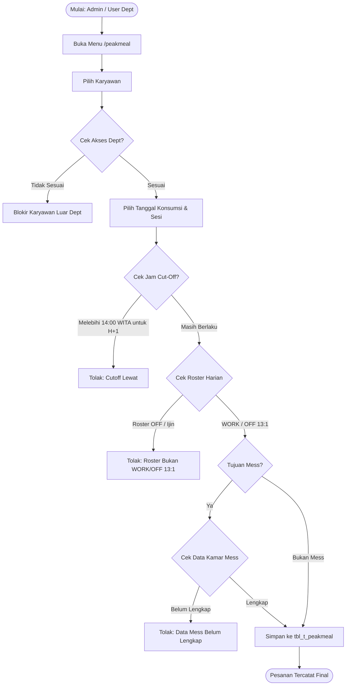
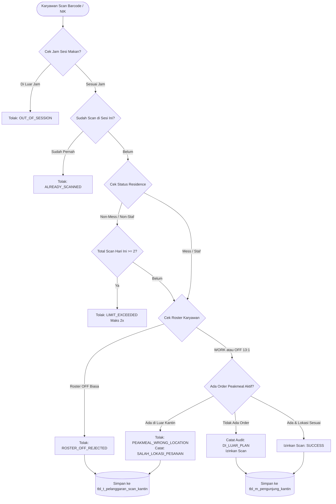
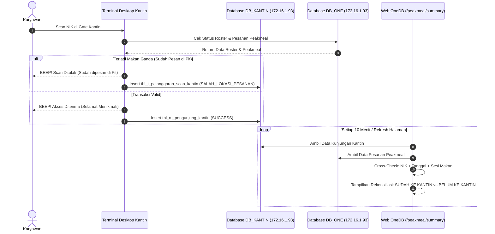

# PANDUAN LENGKAP: ATURAN BISNIS & FLOW SISTEM PEAK MEAL DAN KANTIN DIGITAL

Dokumen ini disusun sebagai acuan operasional dan materi presentasi manajemen terkait integrasi antara **OneDB Peak Meal Portal** (`http://localhost:5004/peakmeal`) dan **Terminal Kantin Digital Desktop** (`D:\4. PROJECT\14. Web\Kantin`).

---

## 1. Executive Summary & Latar Belakang

Integrasi sistem ini dirancang untuk mengatasi 3 tantangan utama operasional konsumsi site:
1. **Pencegahan Makan Ganda (*Double Meal*)**: Mencegah karyawan yang sudah dipesankan makanan kemasan (*packed meal* di Pit/Workshop/Mess) ikut makan prasmanan di kantin.
2. **Kepatuhan Roster & Status Tinggal**: Memastikan hanya karyawan yang bekerja aktif (*WORK* atau *OFF 13:1*) yang berhak makan, serta membatasi jatah makan sesuai status tempat tinggal (*Mess* vs *Non-Mess*).
3. **Pengendalian Anggaran Katering**: Memberikan data akurat sebelum jam masak vendor (*cutoff* ketat) dan pencatatan audit *real-time* atas seluruh transaksi konsumsi.

---

## 2. Jawaban Khusus: Aturan Non-Staf / Non-Mess (Maksimal 2 Kali Makan)

> **Ya, aturan tersebut SUDAH AKTIF di aplikasi Desktop Kantin.**
> 
> Di dalam kode aplikasi desktop (`D:\4. PROJECT\14. Web\Kantin\src\main.js`), sistem mengecek parameter `status_residence` dari database HR (`ONE_DB_MITRA.dbo.vw_m_karyawan_aktif`):
> 
> * **Karyawan NON-MESS / NON-RESIDENCE (Umumnya Non-Staf yang pulang-pergi / tidak tinggal di camp)**:
>   * **Dibatasi maksimal 2 kali makan per hari** (misal: Pagi + Siang, atau Siang + Malam sesuai shift).
>   * Jika melakukan scan ke-3 pada tanggal yang sama, sistem desktop otomatis **MENOLAK** transaksi dengan respon:
>     ```json
>     {
>       "status": "LIMIT_EXCEEDED",
>       "message": "Batas Makan Hari Ini Habis (Non Residen Maksimal 2 Kali)"
>     }
>     ```
> * **Karyawan MESS / RESIDENCE (Staf / Karyawan yang menginap di Mess)**:
>   * Berhak atas **3 kali makan per hari** (Makan Pagi, Makan Siang, dan Makan Malam).

---

## 3. Matriks Aturan Bisnis (*Business Rules Matrix*)

### A. Aturan Web Portal OneDB (`/peakmeal`)

| No | Parameter | Aturan Bisnis | Konsekuensi Pelanggaran |
| :---: | :--- | :--- | :--- |
| **1** | **Hak Akses Departemen** | User Dept hanya bisa memesan karyawan di departemennya. Administrator bisa lintas departemen. | NIK luar departemen otomatis disaring/ditolak. |
| **2** | **Roster Kerja Wajib** | Karyawan **wajib** berstatus roster `WORK` atau `OFF 13:1` pada tanggal yang dipesan. | Ditolak dengan pesan: *"Roster bukan WORK atau OFF 13:1"*. |
| **3** | **Rentang Pengajuan** | • Form Web: Hanya untuk **H+1 s/d H+3** (maks 3 tanggal).<br>• Upload Excel: Diizinkan s/d **1 bulan ke depan**. | Pengajuan di luar tanggal yang diizinkan ditolak. |
| **4** | **Cut-Off Pemesanan H-1** | Pemesanan untuk besok ditutup tepat pukul **14:00 WITA hari ini**. | Form mengunci tanggal besok setelah pkl 14:00 WITA. |
| **5** | **Pengantaran ke Mess** | Jika lokasi tujuan adalah Mess, karyawan wajib memiliki data blok dan kamar aktif di `tbl_m_mess_karyawan`. | Ditolak: *"Data mess/kamar belum lengkap untuk NIK..."*. |
| **6** | **Anti-Duplikasi Pesanan** | 1 NIK tidak boleh memiliki >1 pesanan aktif untuk sesi & tanggal yang sama. | Ditolak: *"Pengajuan sudah ada..."*. |
| **7** | **Batas Revisi / Batal** | Pembatalan atau ganti lokasi maksimal pukul **08:30 WITA di hari H**. | Lewat 08:30 WITA, status pesanan final (sedang dimasak/dikemas). |

---

### B. Aturan Terminal Scanner Kantin Desktop (`Kantin App`)

| No | Parameter | Aturan Bisnis | Respon Scanner |
| :---: | :--- | :--- | :--- |
| **1** | **Sesi Jam Makan** | • Pagi (*Breakfast*): **05:00 - 10:00 WITA**<br>• Siang (*Lunch*): **11:00 - 15:00 WITA**<br>• Malam (*Dinner*): **17:00 - 21:00 WITA** | Di luar jam ini: **TOLAK** (`OUT_OF_SESSION`). |
| **2** | **Frekuensi Scan per Sesi** | Maksimal **1 kali scan** per orang dalam satu sesi makan. | Scan ke-2 di sesi sama: **TOLAK** (`ALREADY_SCANNED`). |
| **3** | **Batas Non-Mess / Non-Staf** | Karyawan Non-Mess dibatasi maksimal **2 kali scan per hari**. | Scan ke-3: **TOLAK** (`LIMIT_EXCEEDED`). |
| **4** | **Roster OFF di Gate** | Karyawan dengan status roster `OFF` dilarang makan di kantin. | Ditolak: **`ROSTER_OFF_REJECTED`** (dicatat pelanggaran). |
| **5** | **Pengecualian OFF 13:1** | Roster `OFF 13:1` **diizinkan** makan prasmanan di kantin. | Scan diterima (*Special Buffet Allowed*). |
| **6** | **Cek Pesanan Peakmeal (*Double Meal*)** | Karyawan yang **SUDAH DIPESANKAN** Peak Meal di area kerja/mess, **DITOLAK** saat scan di kantin office. | **TOLAK**: `PEAKMEAL_WRONG_LOCATION` (*Dicatat Pelanggaran: SALAH_LOKASI_PESANAN*). |
| **7** | **Di Luar Rencana (*Out of Plan*)** | Roster `WORK` tetapi belum dipesankan paket makan. | Diterima makan, namun dicatat audit: `DI_LUAR_PLAN`. |
| **8** | **Ketahanan Jaringan (Offline)** | Jika internet/server putus, scan disimpan di *local queue* SQLite/JSON. | Transaksi tetap berjalan lancar, otomatis sync saat online. |

---

## 4. Alur Kerja Sistem (*System Flowchart*)

### Flow 1: Alur Pemesanan Peak Meal di Web OneDB



---

### Flow 2: Logika Keputusan Scan di Terminal Desktop Kantin



---

### Flow 3: Alur Sinkronisasi & Rekonsiliasi Data



---

## 5. Ringkasan Poin Kunci untuk Presentasi Manajemen

1. **Efisiensi Finansial & Zero Waste**:
   * Sistem otomatis memotong potensi kerugian katering ganda (*double billing*). Karyawan di Pit yang sudah mendapatkan jatah makan tidak bisa mengambil jatah prasmanan di kantin office.
2. **Keadilan Fasilitas (*Fair Quota Distribution*)**:
   * Karyawan Non-Staf / Non-Mess yang pulang ke rumah memiliki batas konsumsi wajar (2 kali/hari).
   * Karyawan Staf Mess yang 24 jam di site diakomodasi 3 kali/hari.
3. **Disiplin Operasional & Akuntabilitas**:
   * Pembatasan *cutoff* pkl 14:00 WITA H-1 memberi kepastian volume belanja bahan baku bagi vendor katering.
   * Setiap upaya pelanggaran (scan saat roster OFF, scan dobel, scan salah lokasi) memiliki *digital footprint* yang terekam lengkap dengan NIK, nama, departemen, dan jam detiknya di tabel `tbl_t_pelanggaran_scan_kantin`.
4. **Sistem Tangguh & Mandiri**:
   * Jika jaringan internet site terganggu, Terminal Kantin tetap melayani karyawan secara offline tanpa membuat antrean macet di pintu kantin, lalu menyinkronkan data secara otomatis saat jaringan pulih.
